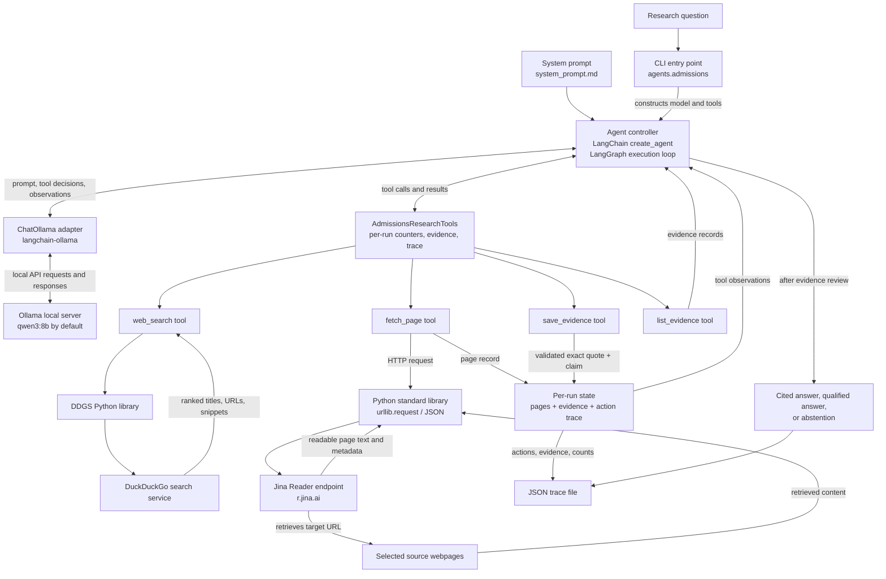

# Admissions Agent Architecture

This diagram shows the command-line research agent and its runtime dependencies. It omits Streamlit and other presentation code: the research loop does not depend on a UI.

## Runtime order

1. `agents.admissions` reads the system prompt, creates a `ChatOllama` model adapter, instantiates per-run research tools, and builds the tool-using agent through LangChain's `create_agent` API. The agent loop is executed using LangGraph.
2. The agent sends the question to the model. The model selects a tool action, and the controller invokes it. This model/tool cycle repeats as needed, so the order of searches and retrievals is adaptive.
3. `web_search` calls the `ddgs` library, which queries DuckDuckGo and returns ranked search results. Snippets are leads only.
4. `fetch_page` sends an HTTP request through Python's `urllib` to the Jina Reader endpoint. Jina retrieves and extracts readable text from the selected webpage; the resulting content and metadata are kept in the per-run page store.
5. The model can call `save_evidence` to store a claim, source, timestamp, exact quote, quality note, verification label, and reason. The tool checks that the page was retrieved and that the quote occurs verbatim. `list_evidence` returns the accumulated records for review.
6. After reviewing evidence, the model returns a cited answer, explains disagreement or uncertainty, or abstains. The controller writes tool actions, evidence, counts, and the final answer to a JSON trace.

## Runtime dependency boundaries

| Component | Role | Dependency or service |
|---|---|---|
| Agent orchestration | Creates and runs the model/tool loop | `langchain` `create_agent`, backed by LangGraph; `langgraph` is also declared as a project dependency |
| Model adapter | Connects LangChain messages and tool calls to the model runtime | `langchain-ollama` (`ChatOllama`) |
| Model runtime | Serves the configured local model | Ollama server and a pulled model such as `qwen3:8b` (not a Python package) |
| Search | Gets ranked web results | `ddgs` Python package and DuckDuckGo service |
| Page retrieval | Fetches readable page content | Python standard library `urllib`; Jina Reader service at `r.jina.ai` |
| Tool schemas | Exposes typed tools to the agent | `langchain-core` `tool` decorator (provided through the LangChain dependency stack) |
| Trace output | Persists run records | Python standard library JSON and filesystem APIs |

The core admissions path does not call the weather tools, Streamlit, `torch`, or `scikit-learn`. `torch` and `scikit-learn` are declared in the project dependencies but are not imported by this runtime path. Network availability and access to DuckDuckGo, Jina Reader, and the local Ollama server are runtime requirements; no separate Python client package is used for Jina.
